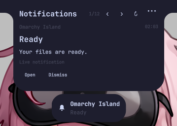

# Omarchy Island

Live activities in your Omarchy quickbar. Music, agent status, notifications, weather, Codex usage, and system pressure share one place that changes with what's happening.

Inspired by Apple's Dynamic Island, built as an independent Quattro user plugin. Island uses your system font and bar colors, runs inside the existing Quickshell process, and requires no Omarchy fork or host patches.

**Development preview.** The renderer and live publishers remain unfinished. This branch is usable for testing, not a claim of complete Apple visual or motion parity.

## Screenshots

Native captures from Omarchy with sample notification text and the installed system theme.

**Notification peek**


**Notification details with a separate live peek**



## What it does

| Activity | What you get |
| --- | --- |
| Downloads | Active browser transfers and recent completions in the desktop Downloads folder, with filename and bytes received. |
| Music | Artwork, playback status, transport controls, and seeking through Quickshell's MPRIS player model. |
| Agents | Working and attention states from an existing Herdr widget or opt-in Codex hooks. |
| Notifications | Short live peeks, recent history, and provider-backed actions. Optional Omapager popup handoff avoids duplicate banners. |
| Codex usage | Available weekly and five-hour allowances, pace, resets, and low-allowance peeks from `lu.codex-usage`. |
| Weather | Current conditions and forecasts after you choose a city or opt into automatic location. |
| System | Sustained CPU, memory, GPU, and resource-pressure observations. No process control or zombie-process alerts. |

The live surface uses islandcn’s split and merge motion. A second activity pinches off into a small bubble. Clicking either activity opens its details. The bar paints the compact background itself. As the Island opens, its shoulders extend past the bar edge using the bar’s current color and opacity, including during theme changes. Glassy mode shares Omarchy’s bar blur rule.

The island appears when there is an activity. Click the song, transfer or alert to expand it in place. Click the original slot or press Escape to close it. A paused track stays available when there is room. When no activity remains, a small handle opens recent notifications. You can open a specific panel with a key binding such as `omarchy-shell luinbytes.island open weather`.

Important changes use a short live peek without opening the full detail view. If details are already open, notifications and requests for attention can appear beneath them. Track changes, playback toggles and agent starts or progress update quietly on the screen where you are reading. Peeks follow each monitor's presenter availability and fullscreen policy.

Peek width follows the longer text line plus its icon and padding, capped to the screen. Opening and closing preserve the compact pill’s width as the panel crosses the bar edge.

## Install

Requires Omarchy with the Quattro user-plugin API. Git and Node.js are needed for the checkout and verification commands below. Weather uses `curl`; the notification-history and system helpers use Node.js.

Plugins run inside your shell process. Review code before enabling it. Install from the default `main` branch with Omarchy's plugin manager:

```bash
omarchy plugin add https://github.com/luinbytes/omarchy-dynamic-island.git
omarchy plugin enable luinbytes.island --section center
```

The plugin ID is `luinbytes.island`. Its manifest lives at the repository root. Nothing belongs in `/usr/share/omarchy`.

An existing installation with this ID must be updated rather than installed again. Optional providers are not installed or patched by Island.

### Disable or remove

To disable Island:

```bash
omarchy plugin disable luinbytes.island
```

If you installed Codex hooks, remove them before moving or deleting the plugin directory:

```bash
node "$HOME/.config/omarchy/plugins/luinbytes.island/scripts/codex-island-hook.cjs" --remove
```

If you installed the optional OMP extension, remove only its dedicated copy before removing Island:

```bash
rm "$HOME/.omp/agent/extensions/omp-island.ts"
```

After removing any installed hooks, remove the plugin through Omarchy:

```bash
omarchy plugin remove luinbytes.island
```

Back up local plugin edits before removal. Island does not uninstall your notification, media, or agent providers.

### Update an existing checkout

Check for local changes first, especially if an agent installed a custom QA build. Do not overwrite those builds with the commands below.

For a clean Git checkout already on `main`:

```bash
cd "$HOME/.config/omarchy/plugins/luinbytes.island"
git status --short
git branch --show-current
```

Stop if the checkout is dirty or on another branch. Preserve custom builds and migrate them separately rather than switching branches over local edits. Otherwise:

```bash
git pull --ff-only origin main
node scripts/verify-scaffold.mjs
omarchy plugin validate .
omarchy-shell shell rescanPlugins
```

Island keeps its service loaded across rescans. To load changed service code in the running shell, briefly disable and re-enable only Island after the rescan:

```bash
omarchy-shell shell setPluginEnabled luinbytes.island false
omarchy-shell shell setPluginEnabled luinbytes.island true
```

## Connect your activities

### Music

Island reads Quickshell's shared MPRIS player model in the existing shell process. It selects a playing player when possible, or the first player with track metadata; you can select another player in Music. Browsers must expose desktop media sessions; mpv needs an MPRIS bridge such as `mpv-mpris`. Unsupported seek or transport actions stay disabled.

### Agents

An existing Herdr widget can supply status. You can also install status-only Codex hooks from the Agents setup view, or inspect and install them with:

```bash
node "$HOME/.config/omarchy/plugins/luinbytes.island/scripts/codex-island-hook.cjs" --print-config
node "$HOME/.config/omarchy/plugins/luinbytes.island/scripts/codex-island-hook.cjs" --install
```

Installation preserves other hook handlers and backs up the existing configuration. Review and enable the hooks in Codex. Island reports observed activity, not proof that an agent's work succeeded. It does not read prompts or transcripts for this integration.

### OMP agent status

OMP loads extensions from `~/.omp/agent/extensions`. Review `scripts/omp-island.ts` and, if no file with this name already exists there, opt in by copying it:

```bash
mkdir -p "$HOME/.omp/agent/extensions"
cp "$HOME/.config/omarchy/plugins/luinbytes.island/scripts/omp-island.ts" "$HOME/.omp/agent/extensions/omp-island.ts"
```

Start a new OMP session, then choose **Observe hooks** in Island's Agents setup. OMP sessions appear as `OMP hooks`; Codex's Install/Remove controls affect Codex only. The extension sends session identifiers and lifecycle status to the local Island shell command. It does not send prompts, transcripts, tool arguments, or tool output. `ask` waits are shown as blocked; tool approvals are shown as approval requested. OMP started inside another agent's shell and headless sessions are excluded. This extension is separate from Herdr's managed OMP integration: do not edit or replace Herdr's file. To stop sending OMP events, remove only `~/.omp/agent/extensions/omp-island.ts` and restart OMP. If you no longer use any hooks, turn off **Observe hooks** too.

### Codex usage

Add the existing `lu.codex-usage` plugin to your bar. Island reads its public usage payload without another poller or credential reader. Missing usage windows stay hidden instead of showing invented values.

Each available window can produce a five-second peek after a cumulative ten-percentage-point drop, below 25%, 10%, or 5% remaining, or when its numeric reset timestamp advances. Startup and data recovery establish a silent baseline. Repeated samples do not repeat warnings.

Reset peeks require the provider's optional `weekly_reset_at` and `session_reset_at` fields. Providers without those fields still support usage-drop alerts. The local provider extension is separate from this repository.

### Browser downloads

Island follows Chromium-family `.crdownload` and Firefox `.part` files in the desktop’s configured Downloads directory. Start a download to see its filename and received size. Click the transfer to expand it, or bind `omarchy-shell luinbytes.island open downloads` to a key. The same command accepts `music` and `notifications`. A rename of the observed partial file marks completion. Removing a partial clears it. Recent completions stay in Downloads for one minute. Files saved directly, private browser temporary directories and custom per-download destinations can fall outside that view. Browsers do not publish a common total-size or pause/resume interface for these files.

### Notifications and Omapager

On Omarchy versions that scope service access, Island follows Omarchy’s persisted live list, recent history and DND state. It supports both the current JSON lists and the older per-notification files. The desktop notification owns actions for this read-only path. Transient notifications that the desktop excludes from storage stay with its native renderer.

Island uses the installed notification backend. With Omapager, it reads admitted live rows and bounded history, and revalidates notification keys before actions. Restored history does not become a new alert.

Omapager's optional `automaticDisplayClaims` hook lets Island replace automatic popups on eligible monitors. Omapager still owns delivery, expiry, history, and actions. Explicit Omapager history and reply views remain accessible. Disabling Island restores Omapager's presentation.

That hook is a separate Omapager-side integration, not a Quattro patch. An Omapager version without it retains its own banners. Island respects DND and global snooze; Omapager retains its critical-notification and verification-code exceptions.

The tested popup handoff and fullscreen-hover fix currently depend on a local Omapager extension that is not distributed here. On stock Omapager, expect its banners alongside Island peeks. Do not disable your notification backend to suppress duplicates; it owns notification delivery. Public release of the extension is tracked as an outstanding integration gate.

### Weather and system activity

Choose a location in Weather, or explicitly enable automatic location. Weather requests go to external weather services; automatic location uses your public IP. There is no silent location lookup before your choice.

System observations are read-only. High utilization is not a crash, a sleeping process is not a stalled process, and Island never kills or restarts applications.

## Verify and troubleshoot

```bash
cd "$HOME/.config/omarchy/plugins/luinbytes.island"
node scripts/verify-scaffold.mjs
omarchy plugin validate .
omarchy-shell shell ping
omarchy-shell luinbytes.island status
```

The status output can contain activity metadata. Redact it before sharing publicly.

For playback troubleshooting, compare `media.active` with `hub.schedule.primaryTool` and `hub.schedule.secondaryTool`. An active media publisher only confirms that MPRIS supplied a track; the hub also needs an accepted activity. `widgets` and `peekTargetScreens` show whether the bar has a live Island presenter. When using a custom build, check the manifest's `entryPoints` before updating or reloading: the running shell may not be using files from your checkout.

Portable tests check models and package contracts. They do not prove QML startup, rendered motion, input behavior, or visual parity. Native QA must inspect the running shell. Some dynamic QML types produce static lint warnings, and startup visibility warnings remain under investigation.

To preview the split and merge in a standalone Qt window, run this from the checkout:

```bash
qml6 shell/plugins/island/SplitMergeFixture.qml
```

The 250 × 22 bar fixture loops through music playing, a download arriving, and the download finishing. Use **Replay** or **Reduced motion** to compare. In a disposable shell with fixtures enabled, the `omarchy-island-fixture splitMerge` IPC method opens the same preview. Motion is adapted from [islandcn](https://github.com/opencoredev/islandcn/tree/0011a41ea4882f3818caf35c98f3ee46b80c4a2c/lib/island) under its [MIT license](shell/plugins/island/islandcn-LICENSE).

Fixtures are for disposable sessions, not your normal desktop. Native checks must cover notification arrival and expiry, playback changes, opening and closing details, multiple monitors, and fullscreen transitions.

## Development

`Service.qml` owns the plugin's activity state. Pure JavaScript models handle selection and presentation. QML components draw and interact with those models. External integrations stay behind their provider boundaries.

## License and release status

Original plugin code is available under the [MIT license](LICENSE). Apple names identify design inspiration, not affiliation or endorsement. Runtime media artwork belongs to its respective owners and is not bundled with this plugin.

Stock-session installation and removal QA and publication of the optional provider extensions remain outstanding. A passing CI run is not native UI acceptance.
